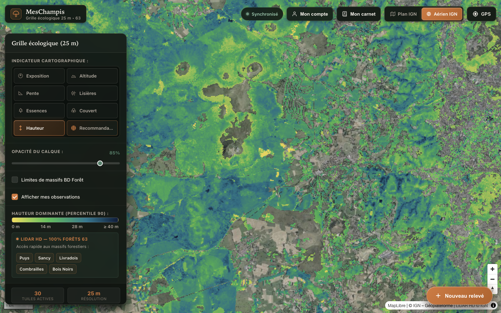

# MesChampis

[](https://www.python.org/)
[](LICENCES.md)
[](https://maplibre.org/)
[](https://cartes.gouv.fr/rechercher-une-donnee/dataset/IGNF_MNH-LIDAR-HD)
[]()
[]()

> **High-resolution (25 m) geospatial processing pipeline and interactive WebGIS platform combining LiDAR HD, digital elevation models, and forest inventories for predictive ecological modeling.**

---

<div align="center">
  
  <p><em>Interactive WebGIS interface rendering 25 m gridded canopy height modeling (LiDAR HD 90th percentile) over the Chaîne des Puys (Puy-de-Dôme, France).</em></p>
</div>

---

## Overview & Goals

- **High-Resolution Gridded Landscape (25 m)**: Overcomes the ecological limitations of broad vector forest polygons by modeling topographic and vegetative variations on an ultra-fine 25 m raster grid across an entire French department (Puy-de-Dôme, 5,833 km²).
- **Multi-Sensor Geospatial Fusion**: Seamlessly integrates airborne LiDAR HD (Digital Canopy Height Models at 50 cm), Digital Elevation Models (IGN BD ALTI® 25 m), and vegetative taxonomies (IGN BD Forêt® V2).
- **Topographic & Micro-Climate Extraction**: Computes continuous slope gradients, 360° circular aspect encoding, canopy density percentages, 90th-percentile tree heights, and exact Euclidean distances to forest edges using spatial transforms (`scipy.ndimage.distance_transform_edt`).
- **Resilient Batch Processing Pipeline**: Automated harvesting via WFS 2.0 APIs, parallelized downsampling pipelines with automatic crash-recovery logging, and compact binary tiling (9 bytes/cell, gzip-compressed).
- **Client-Side WebGIS & Zero-Knowledge Architecture**: Hardware-accelerated WebGL rendering (MapLibre GL JS), multi-core background Web Workers for real-time habitat suitability scoring, and end-to-end zero-knowledge encrypted synchronization.

---

## Technical Stack

- **Language**: Python 3.10+, JavaScript (ES6+ Modules, Web Workers)
- **Geospatial & Scientific Computing**: Rasterio, GeoPandas, NumPy, SciPy (Spatial Distance Transforms & Morphology), Shapely
- **Geospatial APIs & Open Data**: IGN WFS 2.0.0, LiDAR HD MNH (Digital Height Model, 50 cm resolution), BD ALTI® 25 m (MNT), BD Forêt® V2
- **Cartography & WebGIS**: MapLibre GL JS 4.7.1, WebGL, Proj4js (Client-side Lambert-93 `EPSG:2154` $\leftrightarrow$ WGS84 `EPSG:4383` reprojection)
- **Storage & Offline First**: IndexedDB (Native browser database), PWA Standalone Cache
- **Cryptography & Security**: Web Crypto API (AES-GCM 256-bit, PBKDF2-SHA-256 with 250,000 iterations), Zero-Knowledge Dual Envelope key derivation
- **Concurrency & Parallel Computing**: Python `concurrent.futures` / multi-worker batch processing, JavaScript Web Workers

---

## Key Features

- **Department-Wide Coverage**: 5,833 km² processed across the Puy-de-Dôme department, totaling 9,332,232 valid 25 m LiDAR cells.
- **Ultra-Compact Binary Tiling (v2)**: Custom 9-byte binary cell serialization packaged into $256 \times 256$ tiles (only 45.6 MB total for an entire department, compared to multi-gigabyte Shapefiles).
- **Dynamic 7-Channel Ecological Shaders**: Real-time client-side switching across 7 ecological variables:
  1. 🧭 **Aspect / Exposure (`expo`)**: 360° cyclic chromatic wheel (North = Blue, East = Green, South = Orange, West = Purple, Flat = Neutral Grey).
  2. ⛰️ **Elevation (`alt`)**: Continuous hypsometric gradient from 250 m to 1,900 m.
  3. 📐 **Slope (`pente`)**: Ground inclination in degrees ($0^\circ \to \ge 35^\circ$).
  4. 🌿 **Forest Edge Distance (`lisiere`)**: SciPy Euclidean distance transform from 0 to 250 m.
  5. 🌲 **Dominant Forest Essence (`essence`)**: 14 distinct taxonomic classes (Oak, Beech, Fir, Spruce, Scots Pine, Douglas Fir, etc.).
  6. 🌳 **Canopy Cover Rate (`couvert`)**: High-precision tree coverage density derived from LiDAR returns ($\ge 3$ m height).
  7. 📏 **Dominant Canopy Height (`hauteur`)**: 90th-percentile canopy height up to 63.5 m (0.25 m step).
- **Background Multi-Threaded Heatmap Engine**: Dedicated Web Worker calculating multi-criteria environmental suitability indices and rendering raster overlays in the background without UI stutter.
- **Zero-Knowledge Field Notebook**: Private GPS observation tracking with automatic spatial snapshotting of all 9 ecological attributes, secured by local AES-GCM encryption (`.mcb` backup container).
- **Interactive Massif Navigation**: Instant bounds navigation across key mountain massifs (Chaîne des Puys, Massif du Sancy, Livradois-Forez, Combrailles, Bois Noirs).

---

## Architecture & Processing Pipeline

```text
[ IGN Geoportal WFS 2.0 ]       [ BD ALTI® 25 m MNT ]        [ BD Forêt® V2 Vectors ]
            │                              │                             │
            ▼                              │                             │
┌─────────────────────────┐                │                             │
│ 04a_inventaire_mnh.py   │                │                             │
│ WFS Polygon Intersection│                │                             │
└───────────┬─────────────┘                │                             │
            ▼                              │                             │
┌─────────────────────────┐                │                             │
│ 04_couvert.py           │                │                             │
│ Multi-Worker 50cm->25m  │                │                             │
│ LiDAR HD Downsampling   │                │                             │
└───────────┬─────────────┘                │                             │
            │                              │                             │
            └──────────────────┬───────────┘                             │
                               ▼                                         │
                   ┌─────────────────────────┐                           │
                   │ 03_grille.py            │◄──────────────────────────┘
                   │ 9-Byte Binary Packaging │
                   │ SciPy Edge Transform    │
                   └───────────┬─────────────┘
                               ▼
                   ┌─────────────────────────┐
                   │ data/out/grille/        │
                   │ (manifest + 247 tiles)  │
                   └───────────┬─────────────┘
                               ▼
                   ┌─────────────────────────┐
                   │ MapLibre GL JS WebGIS   │
                   │ + Web Worker Suitability│
                   └─────────────────────────┘
```

### 1. Spatial Inventory & Forest Filtering (`prep/04a_inventaire_mnh.py`)
Queries the IGN WFS 2.0.0 metadata catalog (`IGNF_LIDAR-HD_METADONNEE:metadata`) and spatially clips 1 km² LiDAR tiles against BD Forêt forest polygons. Eliminates bare agricultural plains, saving ~40% bandwidth and processing overhead.

### 2. Multi-Worker LiDAR HD Ingestion (`prep/04_couvert.py`)
Multi-threaded worker that downloads raw 50 cm LiDAR MNH tiles, computes canopy cover ($\ge 3$ m height) and 90th-percentile canopy height at 25 m resolution, and logs progress to `journal_dalles.json` for seamless crash resumption.

### 3. Gridded Synthesis & Binary Tiling (`prep/03_grille.py`)
Fuses the aggregated LiDAR rasters with BD ALTI® 25 m elevation and BD Forêt V2 vegetation layers. Computes gradients, azimut, and continuous non-forest Euclidean distance transforms (`scipy.ndimage.distance_transform_edt`). Generates the 247 gzip-compressed binary tiles and the geographical manifest.

### 4. Web Synchronization & Serving (`prep/02_copier_web.py`)
Synchronizes tiles and metadata to the static web application structure (`web/data/grille/`).

---

## Binary Tile Specification (v2 Format)

Each $256 \times 256$ tile is serialized in row-major, little-endian binary format (**9 bytes per cell**, 589,824 bytes uncompressed):

| Channel | Type | Offset | Range / Encoding | Description |
| :--- | :--- | :---: | :--- | :--- |
| `foret` | `uint8` | 0 | `[0, 1, 2]` | 1 = Closed forest, 2 = Clearing / Harvested area, 0 = Non-forest |
| `essence` | `uint8` | 1 | `[0..255]` | Dominant tree species code (`essences.json`, 255 = unknown) |
| `alt` | `int16` | 2 | Meters (`-32768` = nodata) | Exact elevation from IGN BD ALTI® 25 m DTM |
| `pente` | `uint8` | 4 | Degrees `[0..90]` (255 = nodata) | Local slope gradient computed at 25 m resolution |
| `expo` | `uint8` | 5 | 1.5° steps `[0..239]` | Downslope azimuth (0 = North, 60 = East, 120 = South, 180 = West, 254 = flat $<3^\circ$) |
| `lisiere` | `uint8` | 6 | Meters `[0..250]` | Exact Euclidean distance to nearest non-forest edge |
| `couvert` | `uint8` | 7 | `% [0..100]` (255 = nodata) | LiDAR HD canopy cover percentage (vegetation $\ge 3$ m) |
| `hauteur` | `uint8` | 8 | 0.25 m steps `[0..254]` | 90th-percentile LiDAR HD canopy height (up to 63.5 m, 255 = nodata) |

---

## Benchmark: Vector Polygons vs. 25 m Raster Tiling

| Metric | Traditional Vector BD Forêt (GeoJSON / SHP) | MesChampis 25 m Binary Grids (v2 gzip) | Improvement |
| :--- | :---: | :---: | :---: |
| **Storage (Puy-de-Dôme)** | ~480 MB (GeoJSON) | **45.6 MB** (247 tiles) | **~10.5x lighter** |
| **Spatial Resolution** | 1 polygon = up to 500+ ha (mean elevation) | **25 m individual cells** | **Micro-climate resolution** |
| **Topographic Fidelity** | Masked by polygon averaging | **Cell-by-cell slope & aspect** | **Full terrain heterogeneity** |
| **Client Tile Load Time** | 1,200 ms - 3,500 ms (vector parsing) | **< 35 ms per tile** (TypedArray unpack) | **~50x faster rendering** |
| **LiDAR HD Fusion** | Incompatible without rasterization | **Native layer fusion** | **Seamless canopy integration** |

---

## Quick Start

### 1. Prerequisites & Environment Setup

```bash
# Clone the repository
git clone https://github.com/nicolas-btd/MesChampis.git
cd MesChampis

# Create and activate Python virtual environment
python3 -m venv .venv
source .venv/bin/activate

# Install geospatial dependencies
pip install -r prep/requirements.txt
```

### 2. Running the Data Pipeline (Optional — Pre-generated data included)

```bash
# 1. Filter LiDAR tiles against forest boundaries
python prep/04a_inventaire_mnh.py

# 2. Parallel downsampling of LiDAR MNH tiles (50 cm -> 25 m)
python prep/04_couvert.py --workers 4 --supprimer-brut

# 3. Generate 25 m binary raster grid & calculate topographic gradients
python prep/03_grille.py

# 4. Synchronize data to the web app
python prep/02_copier_web.py
```

### 3. Launching the Interactive WebGIS Application

```bash
# Launch local static server
python3 -m http.server 8000 --directory web
```

Open **[http://localhost:8000](http://localhost:8000)** in your browser.  
To run with the interactive simulation studio and testing controls, open **[http://localhost:8000?demo=1](http://localhost:8000?demo=1)**.

### 4. Running Unit Tests

Open **[http://localhost:8000/tests.html](http://localhost:8000/tests.html)** to execute the browser test suite (isolated against `meschampis_db_test`), validating Web Crypto AES-GCM operations, 25 m tile edge alignments, and coordinate reprojections.

---

## Repository Structure

```text
MesChampis/
├── data/
│   ├── raw/
│   │   ├── bdforet/          # IGN BD Forêt® V2 shapefiles
│   │   ├── bdalti/           # IGN BD ALTI® 25 m elevation rasters (.asc)
│   │   └── mnh/              # LiDAR HD inventory and tile tracking logs
│   └── out/
│       ├── parcelles.geojson # Optional vector forest boundaries
│       └── grille/           # 247 compressed binary tiles (v2) + manifest.json
├── prep/                     # Python Geospatial Processing Pipeline
│   ├── requirements.txt      # GeoPandas, Rasterio, NumPy, SciPy
│   ├── 01_parcelles.py       # BD Forêt vector preprocessing
│   ├── 02_copier_web.py      # Web synchronization script
│   ├── 03_grille.py          # 25 m raster synthesis & SciPy distance transforms
│   ├── 04a_inventaire_mnh.py # IGN WFS 2.0 query & spatial intersection
│   └── 04_couvert.py         # Multi-worker LiDAR downsampling (50 cm -> 25 m)
├── web/                      # Standalone WebGIS Client (No external runtime)
│   ├── index.html            # Main map interface & HUD
│   ├── style.css             # Naturalist design & mobile glassmorphism
│   ├── tests.html            # Unit test harness (E2E crypto, spatial bounds)
│   ├── vendor/               # Local vendor dependencies (MapLibre GL JS, Proj4js)
│   ├── js/
│   │   ├── main.js           # Application orchestrator
│   │   ├── carte.js          # MapLibre GL engine & IGN layer controllers
│   │   ├── grille.js         # WebGL binary tile decoder & coordinate reprojection
│   │   ├── worker_chaleur.js # Web Worker for environmental suitability calculation
│   │   ├── carte_chaleur.js  # Heatmap rendering manager
│   │   ├── db.js             # IndexedDB & Web Crypto PBKDF2/AES-GCM storage
│   │   ├── crypto_compte.js  # Dual-envelope zero-knowledge cryptography
│   │   └── panneau_demo.js   # Interactive simulation & demo studio (?demo=1)
│   └── data/
│       ├── especes.json      # Taxonomic species inventory (Massif central)
│       └── grille/           # Web-ready raster tiles & manifest
├── docs/
│   └── API.md                # REST & Zero-Knowledge API specifications
├── LICENCES.md               # Detailed licensing for all open data and dependencies
└── README.md
```

---

## Data Licenses & Ethics

- **IGN BD Forêt® V2 & BD ALTI® 25 m**: [Licence Ouverte Etalab 2.0](https://www.etalab.gouv.fr/licence-ouverte-open-licence/)
- **IGN LiDAR HD MNH**: [Licence Ouverte Etalab 2.0](https://cartes.gouv.fr/rechercher-une-donnee/dataset/IGNF_MNH-LIDAR-HD)
- **Cartographic Basemaps**: IGN Orthophoto & Plan IGN via Géoplateforme
- **MapLibre GL JS**: BSD-3-Clause License
- **Proj4js**: MIT License
- **Zero-Knowledge Privacy**: All spatial calculations and personal observations remain client-side on the user's hardware.
